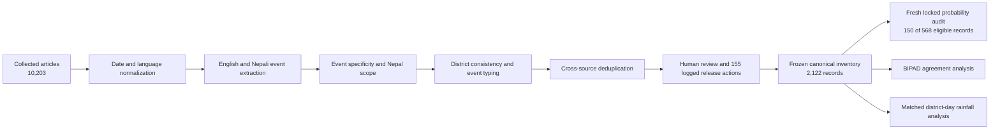

# v1.5 Methods and Data

**Generated file - do not edit numeric results by hand.** Rebuild with
`PYTHONPATH=src python3 scripts/build_v15_methods_data.py`.

## Processing workflow

The workflow preserves raw article evidence separately from canonical events.
External BIPAD and COOLR records are never silently inserted into the news
inventory, preventing circular validation. Full article text remains in the
local evidence database and is not part of the public release.

## Corpus and inventory scope

The collection contains 10,203 articles from 17
observed source slugs (16 configured sources plus one
legacy one-row source). The frozen release contains
2,122 canonical report clusters dated 2015-03-07 to
2026-08-09, covering 74 of Nepal's
77 districts. Kanchanpur, Saptari, and Siraha have no retained canonical
record; absence from this media inventory is not evidence of hazard absence.

| Language route | Collected articles | Final representative records |
|---|---:|---:|
| English | 3,005 | 682 |
| Nepali | 7,197 | 1,440 |
| Legacy/unmapped | 1 | 0 |

### Publisher coverage

| Publisher | Language | Collected articles | Final records | Final share |
|---|---|---:|---:|---:|
| deshsanchar | np | 1,200 | 84 | 4.0% |
| ekantipur | np | 411 | 4 | 0.2% |
| himalayan-times | en | 1,011 | 225 | 10.6% |
| kathmandu-post | en | 180 | 42 | 2.0% |
| khabarhub | unknown | 1 | 0 | 0.0% |
| myrepublica | en | 1,013 | 288 | 13.6% |
| nagarik | np | 731 | 262 | 12.3% |
| nepali-times | en | 12 | 1 | 0.0% |
| nepalpress | np | 967 | 253 | 11.9% |
| nepalpress-en | en | 124 | 24 | 1.1% |
| online-khabar | np | 378 | 128 | 6.0% |
| onlinekhabar-en | en | 600 | 84 | 4.0% |
| rajdhani | np | 800 | 30 | 1.4% |
| ratopati | np | 361 | 25 | 1.2% |
| rising-nepal | en | 65 | 18 | 0.8% |
| setopati | np | 1,561 | 447 | 21.1% |
| ujyaalo | np | 788 | 207 | 9.8% |

The three largest representative publishers account for
47.0% of final records. Two publishers occur
only in the development period, three only in the temporal-test period, and
eleven contribute to both. Raw annual counts must therefore be interpreted
alongside publisher composition rather than as an unbiased incidence trend.

## Final inventory composition

| Characteristic | Count | Share |
|---|---:|---:|
| Landslide event type | 1,277 | 60.2% |
| Road-obstruction event type | 839 | 39.5% |
| Multi-article support | 381 | 18.0% |
| Municipality populated | 1,315 | 62.0% |
| Known trigger populated | 914 | 43.1% |
| Death count populated | 602 | 28.4% |
| Missing-person count populated | 192 | 9.0% |
| Injury count populated | 179 | 8.4% |
| Date confidence >=0.78 | 1,837 | 86.6% |
| Date confidence >=0.80 | 1,232 | 58.1% |
| Date confidence >=0.90 | 17 | 0.8% |
| June-September records | 1,722 | 81.1% |

Blank casualty fields mean not reported or not reliably extracted, not zero.
All released rows carry exact ISO-formatted dates structurally, but the locked
audit shows that an exact-looking date is not always the true occurrence date.

## Release corrections and provenance

The v1.5 assembly applied 155 logged actions without changing the
frozen v1.4 source. Every action records its layer, affected ID, changed fields,
reviewer, and notes.

| Release action | Count |
|---|---:|
| `correct_attributes` | 54 |
| `remove_superseded` | 38 |
| `add_reconstructed` | 26 |
| `exclude_reconstruction_candidate` | 24 |
| `merge_into_existing` | 9 |
| `exclude_existing` | 4 |

## Locked validation design

The final evaluation was drawn only after the candidate was frozen. Previously
reviewed events and article evidence were excluded from the eligible frame.
The remaining frame contained 568 records. A 150-record stratified probability
sample used language, time period, event type, and single-versus-multi-article
support as strata. Estimates use inverse-probability weights and confidence
intervals use within-stratum bootstrap resampling. The sample is spent and must
not be reused to validate a repaired future candidate.

| Stratum | Population | Sample | Weight |
|---|---:|---:|---:|
| `en|2015-2018|landslide|single_article` | 60 | 16 | 3.750 |
| `en|2015-2018|road_obstruction|single_article` | 17 | 4 | 4.250 |
| `en|2019-2022|landslide|multi_article` | 8 | 3 | 2.667 |
| `en|2019-2022|landslide|single_article` | 28 | 7 | 4.000 |
| `en|2019-2022|road_obstruction|single_article` | 12 | 3 | 4.000 |
| `en|2023-2026|landslide|multi_article` | 1 | 1 | 1.000 |
| `en|2023-2026|landslide|single_article` | 14 | 3 | 4.667 |
| `en|2023-2026|road_obstruction|single_article` | 25 | 6 | 4.167 |
| `np|2015-2018|landslide|single_article` | 22 | 5 | 4.400 |
| `np|2015-2018|road_obstruction|single_article` | 1 | 1 | 1.000 |
| `np|2019-2022|landslide|multi_article` | 3 | 3 | 1.000 |
| `np|2019-2022|landslide|single_article` | 96 | 25 | 3.840 |
| `np|2019-2022|road_obstruction|single_article` | 41 | 10 | 4.100 |
| `np|2023-2026|landslide|multi_article` | 23 | 6 | 3.833 |
| `np|2023-2026|landslide|single_article` | 115 | 30 | 3.833 |
| `np|2023-2026|road_obstruction|multi_article` | 11 | 3 | 3.667 |
| `np|2023-2026|road_obstruction|single_article` | 91 | 24 | 3.792 |

### Validation results

| Metric | Weighted estimate | 95% CI | Decision |
|---|---:|---:|---|
| Event-existence precision | 0.958 | 0.923-0.986 | pass |
| Usable-record precision | 0.570 | 0.493-0.650 | fail |
| Single-event accuracy | 0.822 | 0.762-0.881 | fail |
| District accuracy | 0.910 | 0.865-0.953 | pass |
| Exact-date accuracy | 0.753 | 0.678-0.823 | fail |
| Municipality accuracy | 0.859 | 0.783-0.923 | descriptive |
| Event-type accuracy | 0.893 | 0.843-0.937 | descriptive |
| Hazard-type accuracy | 0.902 | 0.853-0.944 | descriptive |
| Deaths exact accuracy | 0.867 | 0.813-0.916 | descriptive |
| Duplicate-merge accuracy | 0.942 | 0.826-1.000 | descriptive |

### Observed error taxonomy

Counts below are raw sample counts and may overlap; weighted estimates above
are the inferential results.

| Error category | Sample count |
|---|---:|
| No landslide event | 6 |
| Multiple physical events represented as one record | 25 |
| District incorrect | 12 |
| Exact date incorrect | 32 |
| Municipality incorrect | 11 |
| Duplicate merge incorrect | 1 |

## Annotation reliability

A separate earlier 150-row canonical-event audit was independently reviewed by
two human annotators. This is an annotation-reliability study, not the fresh
v1.5 performance sample. Agreement was 0.973 (kappa 0.874) for whether an event
occurred, 0.969 (kappa 0.897) for district correctness, and 0.823 (kappa 0.613)
for date correctness. Lower date agreement reinforces the final audit's finding
that temporal assignment is the principal unresolved measurement limitation.

## External agreement and rainfall triangulation

The common BIPAD frame contains 2,119
news events and 4,095 harmonized BIPAD
clusters. Tier-A observed overlap is 0.220
versus 0.093
under date permutation. BIPAD is incomplete and is not treated as ground truth.

The rainfall analysis includes 1,278
primary case-days and 5,460
matched controls. Its concurrent temporal-test AUC is
0.686. Deliberate +/-1 and
+/-3-day shifts materially change the selected rainfall window and threshold,
so rainfall is reported as association and convergent validity, not as an
operational early-warning rule.

## Canonical data dictionary

| Field group | Fields | Interpretation |
|---|---|---|
| Identity | `event_id`, `dedup_cluster_id` | Stable event and report-cluster identifiers |
| Time and place | `event_date_ad`, `district`, `province`, `municipality` | Normalized event assignment; exact-date correctness is imperfect |
| Event description | `event_type`, `hazard_type`, `trigger`, `event_granularity` | Parsed and reviewed event characterization |
| Evidence | `representative_url`, `representative_source`, `representative_title`, `sources_json`, `cluster_size` | Traceable article support without redistributing full text |
| Consequences | `deaths`, `missing`, `injured` | Blank means unknown/not reported, never an assumed zero |
| Confidence | `conf_date`, `conf_class`, `extraction_basis` | Pipeline confidence and evidence mode, not calibrated probabilities |
| Scope controls | `specificity_reason`, `in_nepal`, `scope_reason`, `location_consistent`, `location_reason` | Recorded inclusion and location checks |
| Candidate detail | municipality, ward, and place-name JSON fields | Alternative extracted place evidence retained for auditability |

## Interpretation boundary

The release supports a validated high-precision event-detection claim and a
validated district-assignment claim. It does not support claims of census
completeness, high-precision full records, uniformly correct exact dates, or
operational rainfall-warning performance. Publisher concentration, source
turnover, missing districts, and severity-dependent news selection must remain
visible in the paper rather than being treated as nuisance details.

Authoritative release: `nepal_landslide_inventory_v1.5.0_event_detection_validated_20261004`. Canonical SHA-256:
`313745c27218be7989764cc9614b71cc69a9549ff05c483247a6c89bd276ae19`.
